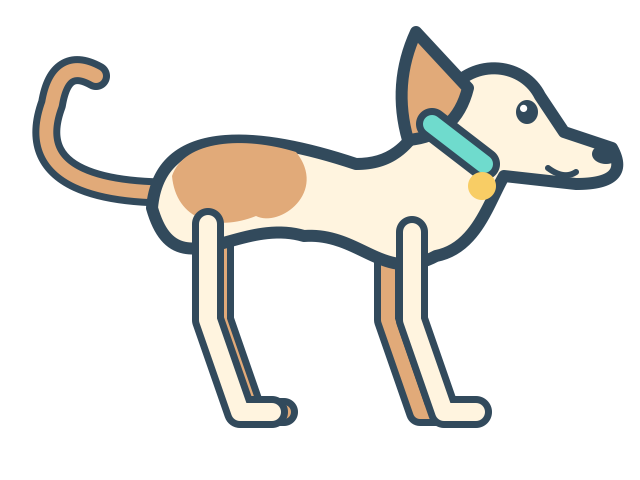

# LokiDot Zoomies

A tiny native macOS desktop pet. A little whippet races left, dips into a rightward sprint, curls down through a loop, then sweeps left and up again.



The pet floats above ordinary windows and lets every click pass through. Find **🐾 Loki** in the menu bar for **Zoomies!**, **Pause / Resume**, **Repeat gently**, **Display**, and **Quit LokiDot Zoomies**.

## Build and run

Requires macOS 13 or later and Xcode 15 or later (with its command-line tools selected). No packages or downloads are needed.

```sh
git clone https://github.com/ashrocket/lokidot-zoomies.git
cd lokidot-zoomies
./scripts/test.sh
./scripts/run.sh
```

`scripts/build.sh` compiles an optimized app for the current Mac architecture, prints its temporary staging path, and saves `dist/LokiDot Zoomies.zip`. `scripts/run.sh` opens that staged app. For a permanent installation, unzip the archive and move the app to Applications in Finder. It uses the installed Swift compiler directly and applies a local ad-hoc code signature. Staging outside synced folders avoids iCloud adding Finder metadata to signed bundles. The app can also be opened from Finder. It is not Developer ID signed or notarized; respect any macOS security prompt. The scripts do not remove quarantine attributes or change security settings.

The included Swift package can also be opened in Xcode, or tested with `swift test`. `scripts/test.sh` runs the same XCTest cases directly without a package-manifest sandbox or external dependencies.

## Life with a zooming whippet

- One 16-second lap starts on launch. **Repeat gently** defaults to on, with 24 seconds of rest between laps. Uncheck it for a single lap and a quiet companion.
- **Pause** freezes both travel and running legs. **Resume** continues from the same point. Selecting **Zoomies!** while already running is disabled, so repeated clicks cannot stack animations.
- The first display is the one containing your pointer. **Display** moves the pet to any connected screen. A lap stays inside that screen's usable area, clear of its menu bar and Dock. Display changes recalculate the route.
- macOS **Reduce Motion** keeps the pet still and disables Zoomies. Changes take effect while the app is running. The native menu follows macOS contrast and transparency preferences.
- Screen sleep and inactive login sessions pause and hide the pet; waking resumes it. A manual pause stays paused.
- Quit with **🐾 Loki → Quit LokiDot Zoomies**. Keyboard equivalents work while the menu is open: ⌘Z for Zoomies, ⌘P for Pause/Resume, ⌘R for repeating, and ⌘Q to quit.

No Dock icon, login item, Accessibility permission, screen-recording permission, network listener, telemetry, or third-party dependency. It does not change your Dot avatar or any other app. Settings are deliberately session-only.

## Artwork

The cream-and-ginger whippet is original vector artwork in `PetArtwork.swift`, released under the same MIT license as the code. It is a substitute mascot: the configured LokiDot avatar was not available to this project. No private profile data, signed download URLs, or extracted assets are included. This is an independent desktop toy, not an official OpenAI app.

## Motion and implementation

AppKit owns one nonactivating, transparent, click-through panel on the selected screen. Core Animation composites a single sprite. Sixteen small running frames are rendered once; position and orientation keyframes are calculated once per lap. There is no per-frame Swift timer or rendering callback. Resting has only one cancellable timer; pause and Reduce Motion stop the animation.

The path uses closed cubic Bézier curves with continuous tangents, an arc-length lookup table, and smooth acceleration and deceleration. A conservative radius keeps the entire banked sprite inside screen bounds. The body turns continuously through a narrow profile when changing direction.

`ZoomiesCore` is independent of AppKit. The tests check rotated-artwork bounds on ordinary, portrait, tiny, and offset displays; loop closure; initial direction; arc-length pacing; monotonic easing; continuous orientation; and invalid progress.

## Development checks

```sh
./scripts/test.sh
./scripts/build.sh
# Export the original artwork without opening a window:
"$(cat dist/app-path.txt)/Contents/MacOS/LokiDotZoomies" --render-art docs/mascot.png
# Test the reduced-motion branch without changing system preferences:
open "$(cat dist/app-path.txt)" --args --reduce-motion
```

Quit an existing instance before using launch flags. Optional `--diagnostics /path/to/report.json` writes a one-time local report after two seconds with the app's own window and animation state. It is off by default and never transmits data.

See [verification notes](docs/VERIFICATION.md) for tested behavior and remaining coverage.

## License

[MIT](LICENSE). Contributions and small, considerate improvements are welcome.
