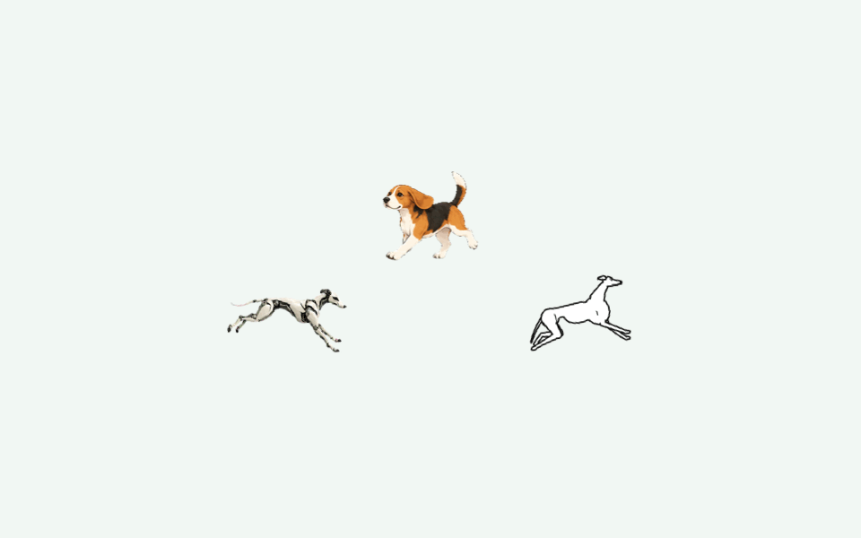

# LokiDot Zoomies 🐾

**[Download for Mac (.pkg)](https://github.com/ashrocket/lokidot-zoomies/releases/latest/download/LokiDot-Zoomies-macos-arm64.pkg)** · **[Download for Windows (.msi)](https://github.com/ashrocket/lokidot-zoomies/releases/latest/download/LokiDot-Zoomies-win-x64.msi)**

| Installer | Requirements | Version |
| --- | --- | --- |
| [Mac PKG](https://github.com/ashrocket/lokidot-zoomies/releases/latest/download/LokiDot-Zoomies-macos-arm64.pkg) | Apple silicon, macOS 13+ | 1.3.2 |
| [Windows MSI](https://github.com/ashrocket/lokidot-zoomies/releases/latest/download/LokiDot-Zoomies-win-x64.msi) | Windows 10/11, x64 | 1.3.2 preview |

[Release notes, portable ZIPs, and SHA-256 checksums](https://github.com/ashrocket/lokidot-zoomies/releases/latest). Both installers are unsigned; the Mac app is locally signed but not notarized. Review your operating system's security prompts. The Windows preview passed automated installer and app checks; interactive desktop testing is still pending. [Windows details](windows/README.md).

Good dogs. Big zoomies. A native Mac app, now with a Windows preview, that lets Loki, a beagle, an illustrated whippet—or your own dog—play on your desktop.

**Version 1.3.2:** pick **Loki Vampire** from the dog menu, or add your own artwork through **Add your dog…**. The regular app includes the vampire alongside Loki, Beagle, and Whippet. It also checks for updates in the background and asks before downloading and installing them.

[Watch Loki Vampire’s Halloween zoomies with an original spooky score](https://github.com/ashrocket/lokidot-zoomies/releases/download/v1.3.2/Halloween-Zoomies-spooky.mp4).



[Watch the happy-prance preview](docs/previews/all-dogs-prance.gif).

## Let them out

**Just want to play on a Mac?** Use the **Mac PKG** link above. Quit Zoomies and open the installer: it installs **LokiDot Zoomies.app** in your `~/Applications` folder without an administrator account. The ZIP remains available: unzip it and move the app there yourself. The downloads target Apple silicon; Intel Mac owners can build from source below. The downloaded app does not need Xcode.

**On Windows?** Open the **Windows MSI** above and launch **LokiDot Zoomies** from the Start Menu. It installs for all users under Program Files, requests administrator approval, and includes its .NET runtime. The portable ZIP runs without installation. See the [Windows preview guide](windows/README.md) for building and current limitations.

To add the command after installing the downloaded app:

```sh
APP="$HOME/Applications/LokiDot Zoomies.app"
"$APP/Contents/Resources/install.sh" --from "$APP"
lokidot
```

**Building from source?** Follow this route:

On a Mac with **macOS 13+ and Xcode 15+** (with its command-line tools selected):

```sh
git clone https://github.com/ashrocket/lokidot-zoomies.git
cd lokidot-zoomies
./lokidot install
lokidot
```

The installer puts **LokiDot Zoomies.app** in `~/Applications` and the command in `~/.local/bin`. If your shell doesn't already include that directory, the installer prints the one-line PATH command to use. You can always run `~/.local/bin/lokidot` directly.

Prefer clicking? Open **LokiDot Zoomies** in Finder, Spotlight, or the Dock. The playground has a dog picker, a move picker, **Let’s go!**, **Pause**, and **Add your dog…**. Closing that window leaves the dogs playing; reopen the app or use the paw menu to get the controls back.

Already built it? `./lokidot` launches without rebuilding. `./lokidot build` makes a fresh build, a ZIP, and a macOS `.pkg` installer in `dist/`. `./lokidot install --no-build` installs that build and its command. The `.pkg` installs the app; use the command above if you also want the optional terminal launcher. The installer packages the standard bundled dogs; personal packs stay in their own folders for **Add your dog…**.

The app is locally signed, not Developer ID signed or notarized; the `.pkg` installer is unsigned. Respect macOS security prompts; the installer does not disable security settings or remove quarantine attributes. Animation runs locally and needs no account, login item, or Accessibility permission.

## Updates

Zoomies checks this repository's latest stable GitHub release in the background. Mac checks run at most once a day; Windows checks shortly after launch and daily while open. **Check for Updates…** checks immediately; the automatic-check setting can be turned off. The app asks before downloading a newer installer, checks its size and SHA-256 against GitHub's release metadata, then hands it to the normal operating-system installer. Finish the installer and reopen Zoomies. Your custom dog folders are preserved.

The Mac controls are in the application and paw menus; the Windows controls are in the app window. Windows installation still needs administrator approval. Details and verification limits: [Mac updates](docs/macos-updates.md) and [Windows updates](docs/windows.md). Update checks use GitHub without an account and never bypass operating-system security prompts.

## A few good commands

```sh
lokidot all                 # The whole pack, one app
lokidot all circle          # Four dogs, little loops
lokidot prance beagle       # Beagle's authored jumping poses
lokidot zoomies loki-vampire # Loki Vampire takes a lap
lokidot zoomies beagle      # Beagle gets the stage
lokidot circle whippet      # Whippet takes a turn
lokidot pause
lokidot resume
lokidot quit                # Everyone goes for a nap
```

`lokidot` opens the playground. `lokidot status` checks whether the app is running. Commands go to the existing app, so you don't need to quit and relaunch just to change a move. When switching to a different build, the launcher asks the older copy to close normally.

| Move | What you'll see |
| --- | --- |
| **Big zoomies** | A broad, curved desktop lap with gentle acceleration and braking. |
| **Little circles** | Two compact loops, a touch of depth, and soft transitions between the authored left and right poses. Dogs stay upright and visible. |
| **Happy prance** | Six small hops, using each dog's actual jumping frames, with soft landings and a short stagger across the pack. |

The paw menu includes **Character**, **Moves**, **Display**, **Pause / Resume**, and **Repeat gently**. A move plays once, then rests for 24 seconds before repeating. Turn off **Repeat gently** for one take. macOS **Reduce Motion** keeps the pets still. Sleep and inactive login sessions hide and pause the overlay.

The desktop overlay is transparent and click-through. Your normal work stays clickable.

## Let your pet remind you

The Mac source build now has **Calendar alarms…** in the playground and paw menu. Connect Apple Calendar, select your calendars, and let your pet nudge you before an event. Google Calendar works through the Google account synced to Apple Calendar on your Mac. Choose an advance reminder, optional sound, and whether event titles appear; alerts have **Snooze 5 min** and **Dismiss**.

```sh
lokidot calendars    # Connect and choose calendars
lokidot alarm-test   # Try an alert without calendar access
```

Keep Zoomies running and the Mac awake. This feature is not in the published 1.3.2 installers or Windows preview yet. [Calendar setup, Google sync, privacy, and alarm behavior](docs/calendar-alarms.md).

## Bring your own best friend

**Your photo → your agent → your dog on the desktop.**

1. In the playground, click **Copy setup prompt**.
2. Paste it into your agent, attach a clear full-body photo, and give your dog's name.
3. Let the agent make the actual artwork and pack, validate it, and show you a preview.
4. Click **Add your dog…** and choose the finished folder. The Mac source build saves a local copy; keep the original as a backup. Published 1.3.2 builds and the Windows preview still need the original folder in place.

The copyable prompt contains the exact grid, manifest fields, validation commands, and launch steps. It tells the agent to deliver working files and an honest validation result. Use an agent with image-generation and file tools; a photo alone is not an animation pack.

From Terminal, copy the same prompt with:

```sh
lokidot dog-prompt | pbcopy
```

Read the [step-by-step dog guide and copy the complete agent prompt](docs/your-dog.md). It includes photo advice, what the finished folder should contain, a drawing guide, and fixes for common problems.

Prefer to make the art yourself? Start with `lokidot new-dog FOLDER NAME`, replace the practice sprite, and run `lokidot validate FOLDER`. Then `lokidot dog FOLDER circle` lets them out. See the [exact format and validator rules](docs/sprite-packs.md).

### Keep a pack, put a pet away

The Mac source build has **Saved pets…** in the playground and paw menu. Imports are saved outside the app, restored on launch, and included in **The whole pack** while loaded. **Unload pet** keeps a pet saved for later. **Remove saved copy…** moves only LokiDot's copy to Trash, leaving your original folder untouched. **Put pets away** clears the desktop and stays off across launches until you choose **Let’s go!** or resume.

```sh
lokidot pets       # Load, unload, or remove saved imports
lokidot unload     # Put all pets away without deleting them
lokidot resume     # Bring the current selection back
```

[Saved-pet storage, duplicate imports, and recovery](docs/saved-pets.md). This feature is not in the published 1.3.2 downloads or Windows preview yet.

The simple pack supports zoomies and circles. Prancing needs a complete **pet-v2** pack with authored jumping poses. Loki, Beagle, and Whippet have them; Loki Vampire currently runs and circles. Choose an individual pet-v2 dog to prance, since the whole pack now includes the vampire.

## Make it yours, or make it better

PRs are welcome: new dog packs with clear artwork rights, better movement, accessibility improvements, and small quality-of-life fixes are all good places to start.

```sh
./lokidot test
./lokidot build
./lokidot all circle

# Validate before sharing a pack:
./scripts/validate-pack.sh /path/to/your-dog

# Build a separately identified app around your own dog:
./scripts/build.sh --pack /path/to/your-dog
```

The [architecture guide](docs/ARCHITECTURE.md) explains the motion model, rendering clock, command routing, and install flow. The [verification record](docs/VERIFICATION.md) distinguishes tested behavior from remaining limits.

| Ready dog | Full pack | Running preview |
| --- | --- | --- |
| Loki | [Atlas](Resources/Characters/robot-loki/atlas.png) · [manifest](Resources/Characters/robot-loki/manifest.json) | [GIF](docs/previews/robot-loki-running.gif) |
| Beagle | [Atlas](Resources/Characters/beagle/atlas.png) · [manifest](Resources/Characters/beagle/manifest.json) | [GIF](docs/previews/beagle-running.gif) |
| Whippet | [Atlas](Resources/Characters/whippet/atlas.png) · [manifest](Resources/Characters/whippet/manifest.json) | [GIF](docs/previews/whippet-running.gif) |
| Loki Vampire | [Atlas](Resources/Characters/loki-vampire/atlas.png) · [manifest](Resources/Characters/loki-vampire/manifest.json) | Select Loki Vampire in the app |

Original code, synthetic fixtures, and bundled artwork for this release are [MIT licensed](LICENSE). Imported artwork retains its own license. See [artwork provenance](docs/ARTWORK.md). LokiDot is an independent desktop toy, not an official OpenAI app, and does not change your existing Dot avatar.
