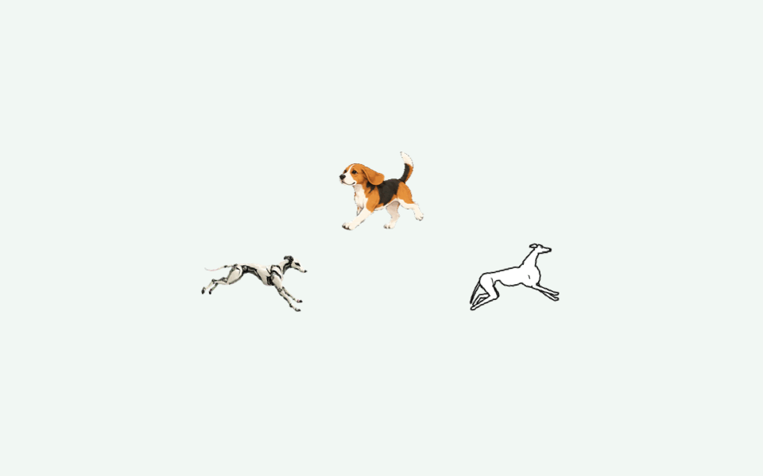

# LokiDot Zoomies 🐾

Good dogs. Big zoomies. A small native Mac app that lets Loki, a beagle, an illustrated whippet—or your own dog—play on your desktop.

**Version 1.3:** a normal app window, a friendly `lokidot` command, little circles, and happy prancing. Pick one dog or let the whole pack loose.



[Watch the happy-prance preview](docs/previews/all-dogs-prance.gif).

## Let them out

**Just want to play?** Download the Apple Silicon app from [GitHub Releases](https://github.com/ashrocket/lokidot-zoomies/releases/latest), unzip it, move **LokiDot Zoomies.app** into `~/Applications`, and open it. The release app does not need Xcode. It is locally signed and not notarized; macOS may ask you to review the app before opening it.

To add the command after installing the downloaded app:

```sh
APP="$HOME/Applications/LokiDot Zoomies.app"
"$APP/Contents/Resources/install.sh" --from "$APP"
lokidot
```

**Building from source?** Follow this route:

On a Mac with **macOS 13+ and Xcode 15+** (with its command-line tools selected):

```sh
git clone https://github.com/ashrocket/lokidot-zoomies.git
cd lokidot-zoomies
./lokidot install
lokidot
```

The installer puts **LokiDot Zoomies.app** in `~/Applications` and the command in `~/.local/bin`. If your shell doesn't already include that directory, the installer prints the one-line PATH command to use. You can always run `~/.local/bin/lokidot` directly.

Prefer clicking? Open **LokiDot Zoomies** in Finder, Spotlight, or the Dock. The playground has a dog picker, a move picker, **Let’s go!**, **Pause**, and **Add your dog…**. Closing that window leaves the dogs playing; reopen the app or use the paw menu to get the controls back.

Already built it? `./lokidot` launches without rebuilding. `./lokidot build` makes a fresh build, and `./lokidot install --no-build` installs that build. `dist/LokiDot Zoomies.zip` contains the app for distribution. No `cat dist/app-path.txt` incantation needed.

The app is locally signed, not Developer ID signed or notarized. Respect macOS security prompts; the installer does not disable security settings or remove quarantine attributes. No server, account, third-party packages, login item, or Accessibility permission is required.

## A few good commands

```sh
lokidot all                 # The whole pack, one app
lokidot all circle          # Three dogs, little loops
lokidot all prance          # A small synchronized celebration
lokidot zoomies beagle      # Beagle gets the stage
lokidot circle whippet      # Whippet takes a turn
lokidot pause
lokidot resume
lokidot quit                # Everyone goes for a nap
```

`lokidot` opens the playground. `lokidot status` checks whether the app is running. Commands go to the existing app, so you don't need to quit and relaunch just to change a move. When switching to a different build, the launcher asks the older copy to close normally.

| Move | What you'll see |
| --- | --- |
| **Big zoomies** | A broad, curved desktop lap with gentle acceleration and braking. |
| **Little circles** | Two compact loops, a touch of depth, and soft transitions between the authored left and right poses. Dogs stay upright and visible. |
| **Happy prance** | Six small hops, using each dog's actual jumping frames, with soft landings and a short stagger across the pack. |

The paw menu includes **Character**, **Moves**, **Display**, **Pause / Resume**, and **Repeat gently**. A move plays once, then rests for 24 seconds before repeating. Turn off **Repeat gently** for one take. macOS **Reduce Motion** keeps the pets still. Sleep and inactive login sessions hide and pause the overlay.

The desktop overlay is transparent and click-through. Your normal work stays clickable.

## Bring your own best friend

**Your photo → your agent → your dog on the desktop.**

1. In the playground, click **Copy setup prompt**.
2. Paste it into your agent, attach a clear full-body photo, and give your dog's name.
3. Let the agent make the actual artwork and pack, validate it, and show you a preview.
4. Click **Add your dog…** and choose the finished folder. Keep that folder somewhere permanent.

The copyable prompt contains the exact grid, manifest fields, validation commands, and launch steps. It tells the agent to deliver working files and an honest validation result. Use an agent with image-generation and file tools; a photo alone is not an animation pack.

From Terminal, copy the same prompt with:

```sh
lokidot dog-prompt | pbcopy
```

Read the [step-by-step dog guide and copy the complete agent prompt](docs/your-dog.md). It includes photo advice, what the finished folder should contain, a drawing guide, and fixes for common problems.

Prefer to make the art yourself? Start with `lokidot new-dog FOLDER NAME`, replace the practice sprite, and run `lokidot validate FOLDER`. Then `lokidot dog FOLDER circle` lets them out. See the [exact format and validator rules](docs/sprite-packs.md).

The simple pack supports zoomies and circles. Prancing needs a complete **pet-v2** pack with authored jumping poses. All three bundled dogs already have them.

## Make it yours, or make it better

PRs are welcome: new dog packs with clear artwork rights, better movement, accessibility improvements, and small quality-of-life fixes are all good places to start.

```sh
./lokidot test
./lokidot build
./lokidot all circle

# Validate before sharing a pack:
./scripts/validate-pack.sh /path/to/your-dog

# Build a separately identified app around your own dog:
./scripts/build.sh --pack /path/to/your-dog
```

The [architecture guide](docs/ARCHITECTURE.md) explains the motion model, rendering clock, command routing, and install flow. The [verification record](docs/VERIFICATION.md) distinguishes tested behavior from remaining limits.

| Ready dog | Full pack | Running preview |
| --- | --- | --- |
| Loki | [Atlas](Resources/Characters/robot-loki/atlas.png) · [manifest](Resources/Characters/robot-loki/manifest.json) | [GIF](docs/previews/robot-loki-running.gif) |
| Beagle | [Atlas](Resources/Characters/beagle/atlas.png) · [manifest](Resources/Characters/beagle/manifest.json) | [GIF](docs/previews/beagle-running.gif) |
| Whippet | [Atlas](Resources/Characters/whippet/atlas.png) · [manifest](Resources/Characters/whippet/manifest.json) | [GIF](docs/previews/whippet-running.gif) |

Original code, synthetic fixtures, and bundled artwork for this release are [MIT licensed](LICENSE). Imported artwork retains its own license. See [artwork provenance](docs/ARTWORK.md). LokiDot is an independent desktop toy, not an official OpenAI app, and does not change your existing Dot avatar.
