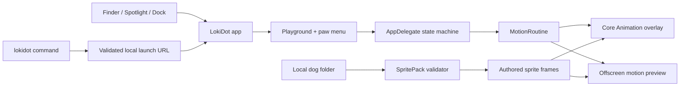

# How LokiDot fits together

LokiDot is a native AppKit app with a shared, testable core. The app, command-line launcher, validator, and preview exporter use the same models. No local HTTP server, network listener, or third-party dependency is involved.

## The core

- **SpritePack** validates a local manifest and PNG, decodes a fixed snapshot, and exposes only declared frames. Unknown fields, unsafe file types, symlinks, traversal, invalid pixels, and incomplete packs are rejected. The app does not execute manifest contents.
- **MotionRoute** builds the broad zoomies path, measures arc length, and supplies continuous tangents. It reserves space for the whole sprite on small, offset, wide, and portrait displays.
- **MotionRoutine** turns progress into a pose for zoomies, circles, or prancing. Poses carry position, facing blend, bank, scale, gait time, and optional jump-frame progress. Every routine closes at its start, easing to rest at both ends.
- **LaunchRequest** is a small, strictly validated command vocabulary. Local URLs accept only show, play, pause, resume, or quit, with a supported move and one dog selection. Unknown, duplicate, conflicting, and malformed options are rejected. Paths are encoded with URLComponents, not shell interpolation.

## One app, two ways to play

**PlaygroundWindow** provides ordinary Mac controls. **AppDelegate** owns character selection, playback state, repeat timing, display changes, sleep, and Reduce Motion. The paw menu and window both reach the same state.

The bundled **lokidot** executable locates its containing app even when invoked through the installed symlink. It sends a URL directly to that app through NSWorkspace, which also delivers commands to an already-running instance. It does not start a second overlay. A different build with the same bundle id is asked to quit normally before switching; a refusal is reported rather than force-killed.

The command validates an imported dog before requesting playback. The app validates again before replacing its current character. A malformed or incomplete pack cannot partially change the selection. The app remembers successful choices locally.

`status` checks the app process; its output is not a claim about which move is playing. Successful launch-command output confirms macOS accepted delivery. The app's diagnostics and visible controls establish playback state.

## Movement and rendering

The overlay is one nonactivating, click-through panel. Each dog has a parent transform layer and two sprite layers. Poses are sampled once at 60 samples per second of animation and submitted as Core Animation keyframes. Core Animation owns playback; there is no per-frame AppKit layout loop.

For turns, the renderer crossfades the separately authored running-left and running-right rows, with bounded foreshortening and banking. Width never collapses to zero. This is an upright 2D turn, not a fabricated 3D body turntable. Gaze frames are not repurposed as body rotations.

Prancing is available only when the pack contains authored jumping frames. The renderer maps each small hop to that sequence. The simple zoomies-v1 format remains valid for running and circles; it does not silently gain invented jump poses.

All dogs share the same Core Animation clock. Pausing freezes position, transforms, and frames together. One completion schedules the group's rest period. Sleep hides the overlay, and Reduce Motion removes animation and holds a resting frame.

**MotionPreview** draws the same poses and frames offscreen, producing a GIF and a six-frame storyboard for review. It is a repeatable visual test, not a substitute for live Mac verification or an FPS measurement.

## Build and install

A build compiles the app, `lokidot`, and SpritePackTool, validates every bundled dog, and signs the resulting bundle locally. Staging lives outside synced Documents folders in the user's cache, or in `LOKIDOT_BUILD_ROOT` when explicitly supplied. The ZIP is the shareable output; the staging path is a build detail.

The installer copies to `~/Applications`, checks the signature, and links `~/.local/bin/lokidot` to the app's helper. Custom destination directories are supported for testing. It refuses to replace an unrelated app, a symlink at the app destination, or an unrelated existing launcher. Updates close the matching app normally and keep the previous app available for rollback until the replacement is committed. Shell startup files and security settings are not changed.

Deleting or moving the source checkout does not break an installed copy. A cache cleanup may remove a development build; `./lokidot` rebuilds when needed. The installed app stays in Applications.

## Contributing

Keep choreography in ZoomiesCore so it can be tested without a desktop session. Add tests for endpoints, bounds, supported artwork, and invalid inputs. Use the same pose model for previews and live rendering. Do not introduce missing-pose fallbacks, gaze-as-body-rotation, mirrored artwork, global keyboard hooks, or a network service for local controls.

## Agent-assisted dog setup

`Resources/DogSetupPrompt.txt` is bundled unchanged and shared by the playground’s Copy setup prompt button and `lokidot dog-prompt`. The app copies instructions locally; it does not upload photos or call an image service. The prompt asks an external agent to produce the artwork and manifest, run the same validator, review a preview, and return the actual folder. A synthetic starter is never presented as the finished dog. The user guide includes the complete prompt and explains the simple-pack versus pet-v2 capability boundary.

Compiler inputs are snapshotted before compilation. Build objects and the module cache live outside synced Documents folders; tests use a temporary source/output snapshot and remove it when finished. `LOKIDOT_BUILD_ROOT` and `LOKIDOT_MODULE_CACHE` can override those cache locations. The standalone pack-tool scripts retain their local `.build/native` output for compatibility.
